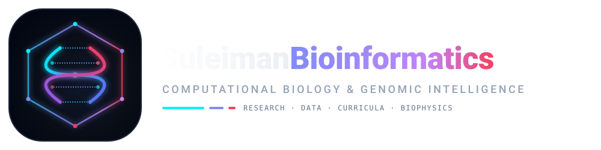

<p align="center">
  <a href="https://suleimanbioinformatics.github.io/">
    
  </a>
</p>

<p align="center">
  <strong>Web Portal and Interactive Computational Biology Suite</strong>
</p>

<p align="center">
  <a href="https://suleimanbioinformatics.github.io/"></a>
  <a href="https://github.com/SuleimanBioinformatics"></a>
  <a href="mailto:suleyman.hacizade1@gmail.com?subject=Access%20Request%20-%20SuleimanBioinformatics%20Private%20Repository"></a>
  <a href="LICENSE"></a>
</p>

---

### Repository Access and Privacy Notice

* **English:** The core computational datasets, algorithms, and research notes (`SuleimanBioinformatics`) are hosted in a private repository. To request academic or research access, please email [suleyman.hacizade1@gmail.com](mailto:suleyman.hacizade1@gmail.com?subject=Access%20Request%20-%20SuleimanBioinformatics%20Private%20Repository).
* **Azərbaycan:** Əsas tədqiqat dataları, alqoritmlər və arxa plan kod bazası (`SuleimanBioinformatics`) qapalı (private) repozitoriyada saxlanılır. Giriş əldə etmək üçün elektron poçt vasitəsilə müraciət edə bilərsiniz: [suleyman.hacizade1@gmail.com](mailto:suleyman.hacizade1@gmail.com?subject=Access%20Request%20-%20SuleimanBioinformatics%20Private%20Repository).

---

## Overview

This repository contains the source code for the official website and client-side computational biology suite for the [SuleimanBioinformatics](https://github.com/SuleimanBioinformatics) organization, deployed via GitHub Pages at [https://suleimanbioinformatics.github.io/](https://suleimanbioinformatics.github.io/).

### Key Features

* **Genomic GC-Skew Analyzer:** Sliding-window GC-skew calculation, AT-skew, nucleotide frequency counts, and reverse complement generation.
* **Kyte-Doolittle Hydropathy Profile:** Amino acid hydropathy evaluation across adjustable window radii with transmembrane segment detection (+1.6 cutoff).
* **3D Biomolecular Structure Viewer:** Client-side 3D Canvas renderer displaying macromolecular coordinates (including Insulin 1COH, alpha-helices, and DNA double helix) with interactive rotation and zoom.
* **Curricula and Research Explorer:** Searchable catalog covering 30 Biopython modules, Cambridge machine learning mathematics lectures, and research concept dossiers.
* **Theme System:** Standard light and dark mode display options.

---

## Repository Structure

```
SuleimanBioinformatics.github.io/
├── assets/                  # Brand vectors, icons, and graphic assets
│   ├── logo.svg             # Primary banner
│   ├── logo-icon.svg        # Vector icon
│   └── logo-emblem.png      # High-resolution emblem
├── css/
│   └── style.css            # Responsive CSS stylesheet
├── js/
│   ├── tools.js             # GC-skew, Kyte-Doolittle, and 3D canvas engine
│   └── app.js               # Theme, search filtering, and tabs controller
├── data/
│   └── curricula.json       # Structured index of modules and syntheses
├── favicon.svg              # SVG favicon
├── favicon.png              # PNG favicon
├── apple-touch-icon.png     # Apple touch icon
├── manifest.json            # Web app manifest
├── .nojekyll                # GitHub Pages static asset bypass
├── index.html               # Main website application
└── README.md
```

---

## Author and Contact

**Suleiman Hajizadeh**  
Bioinformatician and Computational Biologist  
Institute of Molecular Biology and Biotechnologies (IMBB), Azerbaijan  

* Email: [suleyman.hacizade1@gmail.com](mailto:suleyman.hacizade1@gmail.com)  
* Website: [https://suleimanbioinformatics.github.io/](https://suleimanbioinformatics.github.io/)  
* Personal GitHub: [@SuleimanHajizadeh](https://github.com/SuleimanHajizadeh)  
* Organization: [@SuleimanBioinformatics](https://github.com/SuleimanBioinformatics)
